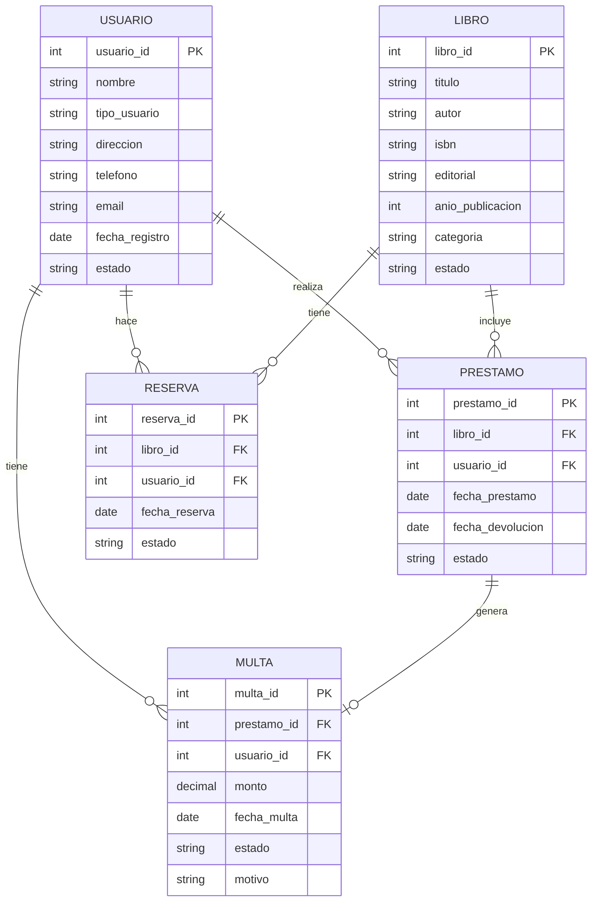

# Modelo Entidad-Relación — Sistema de Gestión de Biblioteca

La imagen del diagrama está en [`MER.png`](MER.png). Debajo está el mismo modelo en
Mermaid, que GitHub dibuja automáticamente al abrir este archivo.

